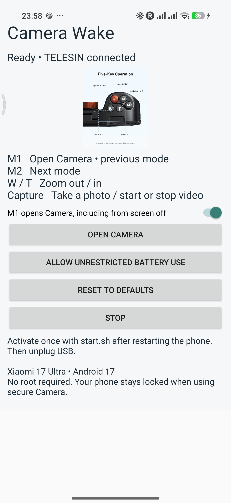

# Camera Wake

Free Android companion for **TELESIN P4-WTP-06**. Hold **M1** to open Xiaomi Camera from screen off; press M1 again to turn the screen off. No root.

## Install & use

[Download the APK](../../releases/latest). Pair **TELESIN_SDC** in Bluetooth, then open Camera Wake:

1. Enable **TELESIN Button Lab** in Accessibility. If blocked, allow restricted settings in App info.
2. Disable **battery optimization** using the app’s setup button. On HyperOS, also set Battery saver to **No restrictions**.
3. When setup shows **Ready**, enable **M1 camera wake**.
4. Screen off → hold M1 → Camera opens. Press M1 again → screen off.

Both setup checks are required. After updates, check the listener is still enabled. No key learning is needed. Button settings show M1/M2 first. Restore defaults keeps learned keys and M1 wake while restoring native actions. Turn camera wake off after case use: **any screen wake can open Camera while enabled**.

**Tested:** Xiaomi 17 Ultra (2512BPNDAG), Android 17 / HyperOS OS3.0.336.0.XPAEUXM, TELESIN P4-WTP-06. Other devices are unverified.

No Internet, ads or accounts. Code and custom logo: **MIT**; product photo: [third-party credit](THIRD_PARTY_NOTICES.md). [Build and advanced details](docs/DETAILS.md).
