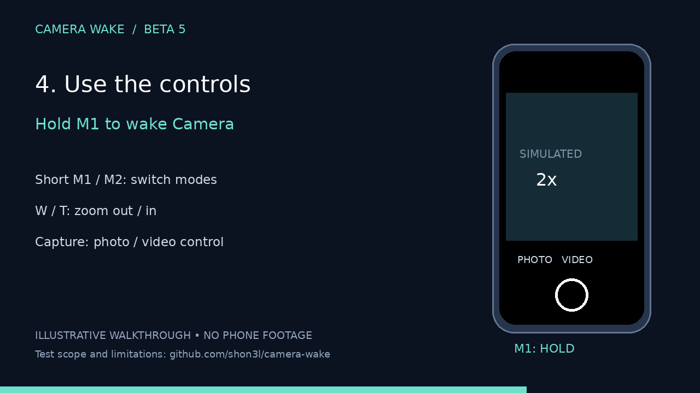

# Camera Wake

A free, open-source companion for the **TELESIN P4-WTP-06 diving phone case**. Hold M1 to wake Xiaomi Camera; hold again to turn the screen off. Native M1/M2, W/T and Capture controls handle modes, zoom and capture.

**No ADB activation, root, account, ads or tracking.**

## Get started

[Download the signed 3.0 release candidate](https://github.com/shon3l/camera-wake/releases/tag/v3.0.0-rc1) · [Firmware guide](docs/FIRMWARE.md) · [Full setup](docs/ACTIVATION.md)

1. Use the official ReefColor app to update the case: the tested path is **V5.7 → V5.9**.
2. **Forget TELESIN_SDC and pair again** in Android Bluetooth settings after updating. This loads the new control layout.
3. Install Camera Wake. Enable its Accessibility service, allow unrestricted battery use and Xiaomi autostart/background permissions as needed.
4. Turn on **Wake with M1**. No button learning or script is needed.

The app keeps the original realistic physical-button guide, with a compact light interface, live setup status and expandable setup. It briefly covers wake/sleep transitions to absorb the remote’s trailing gestures. Allow about two seconds before another action. While wake mode is on, **any screen wake can open Camera**, including phone Power; switch it off after case use.

## Compatibility and release status

The verified hardware baseline is **Xiaomi 17 Ultra, Android 17 / HyperOS OS3.0.336.0.XPAEUXM**, stock Xiaomi Camera, P4-WTP-06 firmware V5.9 after fresh pairing. Beta 5 controls/transitions were physically confirmed; Beta 3.1 passed reboot + first PIN unlock + USB-unplugged testing. The polished 3.0 release candidate has a smaller permission surface and new application identity; its own physical/reboot acceptance is recorded in the [test matrix](docs/COMPATIBILITY.md).

This is a release candidate until those checks pass. Other phones and firmware versions are unverified. [Limitations and technical behavior](docs/DETAILS.md).

## Upgrading from beta or 2.1

The public app is **Camera Wake** (`org.telesin.camerawake`). It installs separately from **Camera Wake Beta** and the ADB-based 2.1 app. Enable the new app’s service and switch; settings are separate. Disable the old service/helper before testing and uninstall old versions once the replacement works. [Upgrade guide](docs/ACTIVATION.md).

Legacy [2.1](https://github.com/shon3l/camera-wake/releases/tag/v2.1.0) and [Beta 5](https://github.com/shon3l/camera-wake/releases/tag/v3.0.0-beta.5) remain available. Samsung was tested only with the legacy workflow, not this public app.

## Demo

[Watch the privacy-safe video](docs/demo/camera-wake-beta5-demo.mp4). This animation illustrates the Beta 5 setup/control behavior shared by 3.0; it does not show the polished interface or a live phone test. No phone footage or personal data is used. [Transcript](docs/demo/README.md).

## Build, licensing and privacy

JDK 17, SDK 35: `./gradlew assembleDebug assembleRelease lintDebug lintRelease`. Regression checks: `python3 scripts/test-policy.py`. [Signing and release process](docs/RELEASING.md).

Code/logo: **MIT**, no charge. The realistic product reference photo has separate rights and attribution in [third-party notices](THIRD_PARTY_NOTICES.md); it is not relicensed under MIT. [Privacy](docs/PRIVACY.md) · [Changelog](CHANGELOG.md) · [Report an issue](https://github.com/shon3l/camera-wake/issues).

Unaffiliated with TELESIN or Xiaomi. GitHub APK distribution; no Play Store listing is claimed.
